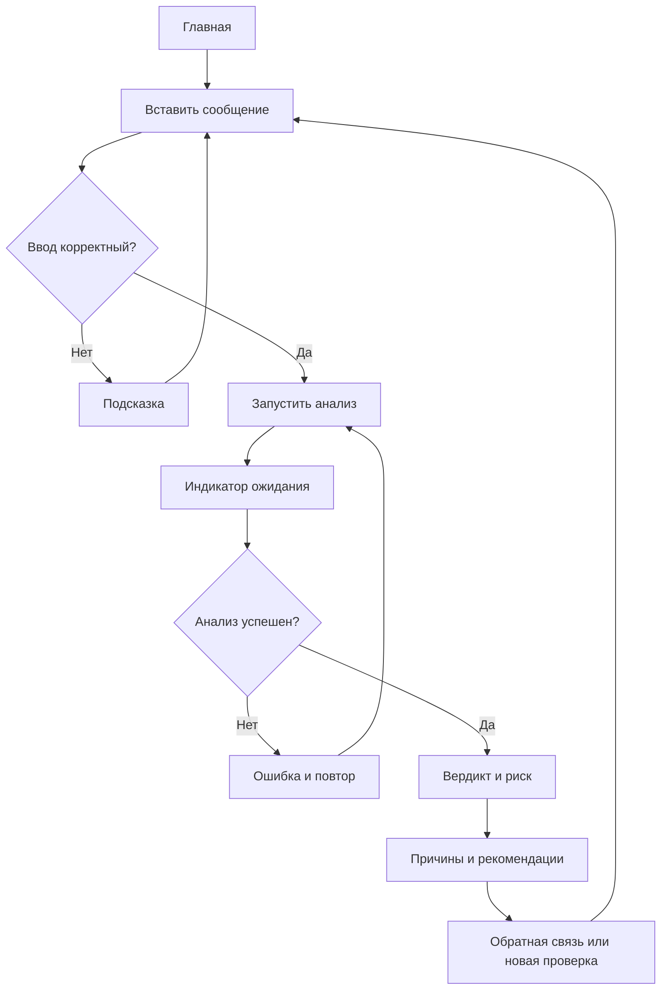

# Бриф ML-продукта «Стоп-Спам»

## 1. О проекте [обязательно]

**Название:** Стоп-Спам (StopSpam).

**Описание:** Веб-приложение для проверки подозрительных сообщений из мессенджеров, почты и социальных сетей. Сервис анализирует текст с помощью машинного обучения, показывает вердикт, объясняет признаки риска и рекомендует безопасные действия.

**Авторы брифа и команда:**

| Участник | Роль | За что отвечает |
|---|---|---|
| Тепин Максим | Разработчик | Архитектура, фронтенд, интеграция и тестирование ML-модели |
| Заика Денис | UI/UX дизайнер | Анализ аудитории и конкурентов, пользовательские сценарии, прототипы, визуальный интерфейс |

## 2. Задача [обязательно]

1. **Задача.** Студенты получают фальшивые вакансии, сообщения о «голосовании за друга», поддельные письма от деканата и предложения стажировок с предоплатой. Им сложно распознавать мошенничество без специальных знаний.
2. **Решение.** Пользователь вставляет текст сообщения и получает один из вердиктов: «Спам», «Фишинг», «Подозрительно», «Вероятно безопасно», а также объяснение признаков (неизвестная ссылка, срочность, просьба перевести деньги и т. п.) и рекомендацию.
3. **Полезное действие.** Студенту не нужно самостоятельно искать сведения о каждом подозрительном сообщении: сервис помогает принять более безопасное решение.
4. **Критерий успеха.** Не менее 80% участников UX-тестирования выбирают безопасное действие после просмотра результата. Дополнительные цели: проверка за 15 секунд и понимание объяснения минимум 80% участников.

## 3. Аудитория [обязательно]

| Сегмент | Кто это | Проблема |
|---|---|---|
| Студенты университетов (приоритет) | 17–25 лет, активные пользователи мессенджеров | Фальшивые сообщения от вуза, голосования и ссылки |
| Начинающие фрилансеры | 18–27 лет | Поддельные заказы и требования предоплаты |
| Соискатели стажировок | Студенты и выпускники | Мошеннические вакансии и фальшивые HR-аккаунты |
| Активные пользователи мессенджеров | Молодые люди | Сложно отличать массовый спам от обычной переписки |

Подробный портрет основного сегмента планируется оформить в `audience.md`.

## 4. Job stories [обязательно]

1. Когда мне присылают ссылку на «голосование за друга», я хочу проверить текст, чтобы не открыть фишинговый сайт.
2. Когда мне предлагают работу, но требуют предоплату, я хочу проверить сообщение, чтобы не потерять деньги.
3. Когда мне приходит письмо якобы от деканата с просьбой срочно подтвердить аккаунт, я хочу оценить признаки угрозы, чтобы не раскрыть личные данные.

## 5. ML-часть [обязательно]

| Вопрос | Ответ |
|---|---|
| Какую задачу решает модель? | Классификация текста на спам и обычные сообщения; дополнительные правила выявляют признаки фишинга и риска. |
| Что пользователь даёт на вход? | Вставленный текст сообщения. |
| Что модель возвращает? | Предсказанный класс и оценку вероятности; система добавляет обнаруженные признаки риска. |
| Как показывается результат? | Карточка с вердиктом, текстовым и цветовым уровнем риска, причинами и рекомендациями. |
| Что будет при ошибке модели? | Возможны ложное чувство безопасности или ошибочная тревога; сервис не гарантирует достоверность оценки. |
| Нужно ли показывать уверенность? | Да, как ориентировочный уровень риска с пояснением, что это не гарантия. |
| Что делать с плохим результатом? | Исправить текст, повторить анализ, отметить ответ как ошибочный. |
| Сколько ждать? | Цель — до 5 секунд; во время ожидания показывать индикатор и возможность повторить запрос при сбое. |
| Откуда модель? | Для MVP: TF-IDF + Logistic Regression на открытых датасетах спама; в будущем — дообученная русскоязычная модель Hugging Face. |

**Техническое ограничение:** бинарная модель «спам / не спам» не различает самостоятельно четыре пользовательских вердикта. В MVP они формируются комбинацией результата модели и прозрачных правил. Для русского языка потребуется релевантный русскоязычный набор данных. Анализ текста не подтверждает репутацию сайта или подлинность отправителя.

## 6. Основной сценарий (user flow) [обязательно]

1. Пользователь открывает главную страницу и видит поле ввода.
2. Вставляет подозрительное сообщение и нажимает «Проверить сообщение».
3. При пустом или некорректном вводе получает понятную подсказку.
4. Во время обработки видит «Анализируем сообщение…» и индикатор загрузки.
5. При успешной обработке получает вердикт, объяснение и рекомендации.
6. При сбое видит сообщение об ошибке и кнопку повторной попытки.
7. Может оценить результат или проверить другое сообщение.

## 7. Границы MVP [обязательно]

| Входит в MVP | Не входит в MVP |
|---|---|
| Веб-страница с вводом текста | Мобильное приложение |
| ML-классификация и правила риска | Автоматическое чтение переписок |
| Четыре понятных вердикта | Telegram-бот |
| Объяснение и рекомендации | OCR и проверка скриншотов |
| Загрузка, ошибки, повторная проверка | Проверка репутации доменов по внешним базам |
| Простая обратная связь | Личный кабинет и облачная история |

## 8. Конкуренты и референсы [обязательно]

- **[VirusTotal](https://www.virustotal.com/):** нравится простая проверка ссылок и наглядные результаты; технические детали могут быть сложны новичкам. Берём минималистичный ввод и визуальное выделение угрозы.
- **[Gmail](https://mail.google.com/):** нравятся предупреждения о подозрительных письмах; причины классификации не всегда понятны. Берём короткие предупреждения и ясные действия.
- **[ScamAdviser](https://www.scamadviser.com/):** нравится оценка риска и пояснения; сервис в первую очередь анализирует сайты, а не тексты сообщений. Берём структурированное объяснение факторов.

**Преимущество:** фокус на студенческих сценариях, анализе текста сообщения и простом объяснении, что именно подозрительно и что делать дальше. Оценки конкурентов предварительные; их предстоит подтвердить UX-анализом.

## 9. Бренд [по желанию]

**Пять слов:** безопасный, понятный, современный, дружелюбный, надёжный.

**Характер:** спокойный цифровой помощник, который не пугает и не обвиняет. Синий — основной цвет; зелёный, жёлтый и красный помогают различать уровни риска, но обязательно дублируются текстом.

## 10. Гипотезы [по желанию]

1. Если объяснять конкретные признаки риска, пользователи лучше распознают мошенничество; проверим сравнением интерфейсов с объяснением и без.
2. Если убрать обязательную регистрацию, больше пользователей завершат проверку; проверим процент завершений сценария.
3. Если показывать текстовый и цветовой индикатор риска, вердикт будет понятнее; проверим скорость и точность интерпретации.
4. Если давать конкретные рекомендации, пользователи чаще выберут безопасное действие; проверим на ситуационных заданиях.

## 11. Что ещё важно знать [по желанию]

- Модель может ошибаться; «Вероятно безопасно» не означает гарантию безопасности.
- Перед проверкой пользователь должен удалить из текста пароли, банковские реквизиты и другие чувствительные данные.
- В MVP не планируется постоянное хранение исходных сообщений; передача на сервер — по HTTPS.
- Главный акцент учебного проекта — UX/UI: удобный ввод, прозрачный ML-результат, понятные ошибки и рекомендации.
- В будущем возможны OCR, Telegram-бот, история проверок и расширенная проверка ссылок.
